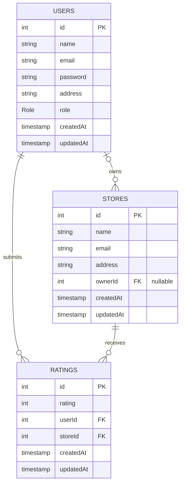

# RateHub

RateHub is a store rating app I built as a full-stack project. People sign up, browse the stores listed on the platform, and rate them from 1 to 5. Store owners can see who rated their place, and an admin keeps an eye on everything.

The demo data is set in Pune (hotels, misal houses, biryani places and so on), so it feels closer to a real use case than the usual "Store 1, Store 2" placeholders.

## Built with

- **Backend:** Express.js + TypeScript, JWT auth, bcrypt for passwords, Zod for validation, and one central error handler. Code is split into routes, controllers and services.
- **Database:** MySQL with Prisma ORM.
- **Frontend:** React 19 + Vite + TypeScript, Tailwind CSS, React Router, Lucide icons.
- **State:** Redux Toolkit with four slices: `authSlice`, `adminSlice`, `storeSlice` and `ownerSlice`.

## Who can do what

### Admin
- Dashboard with total users (split by role), total stores and total ratings.
- Add users with any role (`ADMIN`, `USER`, `STORE_OWNER`) and add stores with an owner assigned.
- Browse all users and stores, filter by name / email / address (and role for users), and sort by the main columns.
- For store owners, the user list also shows their store name and its average rating.
- Open a user's details in a modal.

### Normal user
- Register, log in, and change their password later.
- Browse every store, search by name or address, and sort by name (A-Z / Z-A) or rating (highest / lowest).
- See a store's overall rating next to the rating they gave it.
- Submit a rating, or change it later.

### Store owner
- Log in and get sent straight to their own dashboard. Password can be changed here too.
- See the store's average rating (like 4.67 / 5.00).
- See a table of everyone who rated the store: name, email, address, rating and date. It can be sorted by any of those columns.

## Validation rules

These are checked on both the frontend and the backend.

| Field | Rule |
| :--- | :--- |
| Name | 20 to 60 characters |
| Address | Up to 400 characters |
| Password | 8 to 16 characters, at least one uppercase letter and one special character |
| Email | Must be a valid email address |
| Rating | Whole number from 1 to 5 |

## Database design

There are three tables: `users`, `stores` and `ratings`.

- A user can submit many ratings.
- A store can receive many ratings.
- A store can have an owner, who is a user with the `STORE_OWNER` role. `ownerId` is optional, so a store can exist without an owner and be assigned one later.

### ER diagram



### Prisma schema

```prisma
enum Role {
  ADMIN
  USER
  STORE_OWNER
}

model User {
  id        Int      @id @default(autoincrement())
  name      String
  email     String   @unique
  password  String
  address   String
  role      Role     @default(USER)
  createdAt DateTime @default(now())
  updatedAt DateTime @updatedAt

  stores    Store[]  @relation("StoreOwner")
  ratings   Rating[]

  @@map("users")
}

model Store {
  id        Int      @id @default(autoincrement())
  name      String
  email     String   @unique
  address   String
  ownerId   Int?
  createdAt DateTime @default(now())
  updatedAt DateTime @updatedAt

  owner     User?    @relation("StoreOwner", fields: [ownerId], references: [id])
  ratings   Rating[]

  @@map("stores")
}

model Rating {
  id        Int      @id @default(autoincrement())
  rating    Int
  userId    Int
  storeId   Int
  createdAt DateTime @default(now())
  updatedAt DateTime @updatedAt

  user      User     @relation(fields: [userId], references: [id])
  store     Store    @relation(fields: [storeId], references: [id])

  @@unique([userId, storeId])
  @@map("ratings")
}
```

## Demo accounts

The seed script creates these. Every account uses the password `Password@123`.

| Role | Email | Name / Store |
| :--- | :--- | :--- |
| Admin | `admin@punehotelrating.in` | Pune Platform Administrator |
| Store owner | `sandeep.joshi@hotelsahyadri.in` | Hotel Sahyadri Residency (Shivajinagar) |
| Store owner | `vaishali.deshpande@malhargarden.in` | Hotel Malhar Garden Restaurant (Baner) |
| Store owner | `prashant.patil@peshwawada.in` | Hotel Peshwa Wada Misal House (Budhwar Peth) |
| User | `rohan.kulkarni@gmail.com` | Rohan Anilkumar Kulkarni |
| User | `priyanka.bhosale@gmail.com` | Priyanka Sanjay Bhosale |

The seed also adds a few more owners, users and stores, plus around 28 ratings, so the dashboards and sorting have something to show. The login screen has one-click buttons for the demo accounts.

All names, emails and business names in the seed data are made up.

## Running it locally

### 1. Database

You need MySQL running on `localhost:3306`. Create the database first:

```sql
CREATE DATABASE store_rating_db CHARACTER SET utf8mb4 COLLATE utf8mb4_unicode_ci;
```

### 2. Backend

```bash
cd server
npm install
npx prisma db push
npx prisma db seed   # or: npm run seed
npm run dev
```

The API runs at `http://localhost:5000/api`.

If PowerShell blocks scripts on Windows, run `cmd /c npm run seed` or `npx.cmd prisma db seed` instead.

### 3. Frontend

```bash
cd client
npm install
npm run dev
```

The app runs at `http://localhost:5173`.